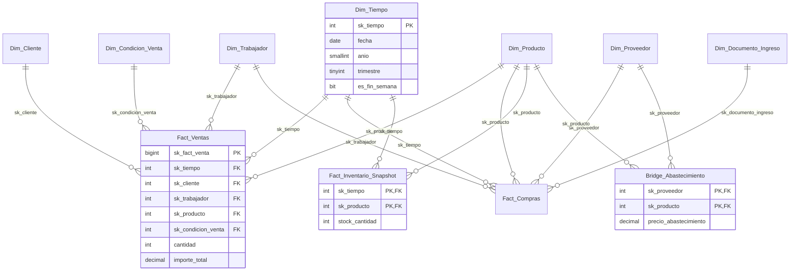

# Esquema en estrella — `proyecto_dw` (MiniMarket)

Documento de diseño dimensional del DW. Define el **grano**, las **dimensiones**, las
**medidas** y las **reglas de integridad** que deben respetarse tanto en la BD como en
el data lake (raw/processed) que alimenta Power BI.

---

## 1. Panorama

Modelo **en estrella** (no copo de nieve): los hechos están al centro y se relacionan
solo con dimensiones. No hay relaciones hecho–hecho.

```
                      Dim_Tiempo
                     /     |      \
                    /      |       \
      Dim_Cliente--+   Dim_Producto   Dim_Condicion_Venta
                    \      |       /   (dimensión basura)
                     \     |      /
                      Fact_Ventas
                      Fact_Compras ---- Dim_Proveedor
                      Fact_Inventario_Snapshot

   Bridge_Abastecimiento  (N:M Producto–Proveedor, con precio de abastecimiento)
```

- **11 tablas**: 7 dimensiones + 1 puente + 3 hechos.
- **Dimensiones conformadas** (compartidas entre varios hechos): `Dim_Tiempo`, `Dim_Producto`, `Dim_Trabajador`.
- **Medidas**: solo en las tablas de hechos (nunca en las dimensiones).

---

## 2. Tablas de hechos

| Hecho | Grano (una fila =) | Medidas | Aditividad |
|---|---|---|---|
| `Fact_Ventas` | una **línea** de comprobante de venta | `cantidad`, `importe_total`, `precio_unitario` (calculada) | Aditiva en todas las dimensiones; aditiva en tiempo |
| `Fact_Compras` | una **línea** de ingreso de mercancía | `cantidad`, `precio_unitario`, `subtotal` (calculada) | Aditiva; aditiva en tiempo |
| `Fact_Inventario_Snapshot` | **producto × día** (snapshot) | `stock_cantidad` | **Semi-aditiva**: se suma en productos y días, **nunca** a lo largo del tiempo (el stock no se acumula) |

Claves y notas:
- PK de `Fact_Ventas`: `sk_fact_venta` (BIGINT IDENTITY). PK de `Fact_Compras`: `sk_fact_compra`.
- PK de `Fact_Inventario_Snapshot`: compuesta `(sk_tiempo, sk_producto)` → **ya garantiza la unicidad del grano**.
- `precio_unitario` (ventas) y `subtotal` (compras) son **columnas calculadas PERSISTED**: no se escriben, se derivan. Importante para el ETL: en la extracción vienen ya calculadas y **son consistentes por definición** con `cantidad` e `importe_total`.
- Dimensiones **degeneradas** (viven dentro del hecho, no se dimensionan): `nro_comprobante`, `id_detalle` (ventas); `id_ingreso`, `id_detalle_ingreso`, `nro_documento` (compras). Sirven para rastrear el documento de origen.

## 3. Dimensiones

| Dimensión | PK (surrogate) | Clave de negocio | SCD | Notas |
|---|---|---|---|---|
| `Dim_Tiempo` | `sk_tiempo` (= fecha AAAAMMDD) | `fecha` | No | Calendario completo; `es_fin_semana` precalculado |
| `Dim_Cliente` | `sk_cliente` IDENTITY | `id_cliente` | **Tipo 2** | `fecha_inicio/fecha_fin/es_vigente`; UNIQUE `(id_cliente, fecha_inicio)` |
| `Dim_Producto` | `sk_producto` IDENTITY | `cod_producto` | **Tipo 2** | Tipo y estado **desnormalizados** (correcto en estrella) |
| `Dim_Proveedor` | `sk_proveedor` IDENTITY | `id_provedor` | **Tipo 2** | `limite_credito`, `plazo_pago_dias`, `tipo_pago` |
| `Dim_Trabajador` | `sk_trabajador` IDENTITY | `id_trabajador` | **Tipo 2** | `tipo_trabajador`, `cat_laboral` |
| `Dim_Condicion_Venta` | `sk_condicion_venta` IDENTITY | (4 atributos) | No | **Dimensión basura**: tipo_comprobante, tipo_venta, metodo_pago, estado_pago |
| `Dim_Documento_Ingreso` | `sk_documento_ingreso` IDENTITY | (2 atributos) | No | **Dimensión basura**: tipo_documento, tipo_pago |

Puntos clave:
- **SCD-2** en las 4 dimensiones "maestras": cada versión tiene su `sk` propio; el hecho apunta a la versión concreta. Por eso la clave de negocio **no** puede ser la clave foránea del hecho.
- `es_vigente` ↔ `fecha_fin IS NULL` es la invariante que valida la ETL (`scd_inconsistente`).
- La **dimensión basura** evita repetir 4–6 columnas de texto en cada línea de venta; su clave es compuesta por los propios atributos.

## 4. Tabla puente

`Bridge_Abastecimiento (sk_proveedor, sk_producto, precio_abastecimiento)` modela la relación N:M
"qué proveedores abastecen qué productos". En Power BI se relaciona **en un solo sentido (single) desde
las dimensiones hacia el puente**, y el puente hacia los hechos → relación muchos-a-muchos
("*cross-filter direction*"). `precio_abastecimiento` es un **atributo del puente** (no una medida
del hecho): depende de la relación, no del evento.

---

## 5. Reglas de integridad del modelo

| # | Regla | Dónde se verifica |
|---|---|---|
| R1 | Toda FK de un hecho existe en su dimensión | ETL (`VALIDACION_REFERENCIAL`) + `vw_evaluacion_calidad` |
| R2 | No hay claves de negocio duplicadas dentro de una versión | ETL + vista de calidad |
| R3 | `fecha_fin IS NULL` ⟺ `es_vigente = 1` | ETL + vista de calidad |
| R4 | **Coherencia temporal SCD**: la fecha del hecho cae dentro de la vigencia de la versión de la dimensión que referencia | `vw_consistencia_scd_temporal` (nuevo) |
| R5 | Un hecho no puede apuntar a una versión de dimensión *futura* respecto a su fecha | misma vista R4 |
| R6 | Grano único: `(sk_producto, sk_tiempo)` en el snapshot; `(nro_comprobante, id_detalle)` en ventas | UNIQUE en BD + vista de calidad |

### R4 en detalle (la regla que casi nadie implementa)

Un hecho con `sk_tiempo = 20260131` que referencia un cliente cuya versión actual empezó el
20260210 es **históricamente incorrecto**: el reporte saldría de la versión equivocada. La condición:

```sql
dim.fecha_inicio <= hecho.fecha  AND  (dim.fecha_fin IS NULL OR hecho.fecha <= dim.fecha_fin)
```

> **Ojo con la semántica de `fecha_fin`**: en `sp_carga_scd2.sql` la versión anterior se cierra con
> `fecha_fin = @Fecha`, que es **el mismo día** en que empieza la nueva versión (solapamiento de 1 día).
> Recomendación: cerrar con `fecha_fin = DATEADD(DAY, -1, @Fecha)` para que las vigencias sean
> contiguas y sin ambigüedad. El parche está en `esquema_estrella_mejoras.sql` (bloque opcional).

---

## 6. Diagrama



---

## 7. Observaciones y debilidades detectadas

| # | Hallazgo | Impacto | Acción |
|---|---|---|---|
| D1 | Sin índice en `sk_trabajador` (Fact_Ventas/Fact_Compras) | Full scan en análisis por vendedor/comprador | Índice (en `esquema_estrella_mejoras.sql`) |
| D2 | Sin índice en `sk_producto` del snapshot | El PK empieza por `sk_tiempo`; consultar por producto es lento | Índice |
| D3 | Sin CHECK constraints en la BD | La BD acepta `cantidad = -5`; la ETL solo lo detecta si alguien extrae | CHECK constraints opcionales |
| D4 | `fecha_fin` con 1 día de solapamiento entre versiones | Ambigüedad al reportar por fecha exacta | `fecha_fin = fecha_inicio - 1` |
| D5 | No existe regla de coherencia temporal SCD (R4) | Reportes históricos con la versión equivocada | Vista nueva incluida |
| D6 | `Fact_Inventario_Snapshot` crecerá ~80 filas/día (productos × días) | A 2 años ≈ 60k filas (ok), a 5 años con más productos, ~150k+ | Columnstore cuando crezca |
| D7 | Sin `Dim_Comprobante` (documento de venta) | No se puede analizar "por tipo de comprobante" más allá de la dim basura | Opcional, no bloqueante |
| D8 | Sin medida de margen/descuento en ventas | No se puede medir rentabilidad | Opcional: `descuento`, `impuesto` |

---

## 8. Puente con el data lake

El data lake (capas `raw/` y `processed/`) **es la proyección tabular de esta estrella**:

```
proyecto_dw (SQL Server)          ETL (Python)                  Power BI
─────────────────────────         ─────────────                  ────────
Fact_Ventas ─┐
Fact_Compras ─┼─ SELECT * ─▶ raw/*.csv ─▶ reglas RNF03 ─▶ processed/*_Limpio.csv ─▶ Import CSV
Dim_* ───────┘                (SQL Server → raw)   (raw → processed)
```

Reglas que el modelo impone al lake (ya implementadas en `reglas_limpieza.py`):

1. **Las claves `sk_*` son la costura** entre capas: el ETL valida que cada `sk` del hecho exista
   en la dimensión (R1) antes de publicar `processed/`.
2. **El grano no cambia al salir de SQL**: una fila en `raw/` = una fila en `processed/` = un
   hecho en Power BI. Si el lake duplica filas, el modelo se rompe.
3. **La granularidad del snapshot es `(producto, día)`**: no se deben sumar snapshots en el lake
   (semi-aditividad): Power BI debe tomar el último snapshot del periodo.
4. **Las filas descartadas no se borran**: van a `processed/rechazados/` con `motivo_rechazo`,
   y `vw_evaluacion_calidad` + `Aud_Calidad_Datos` son la evidencia de que la regla se aplicó.
5. **El conteo de la BD y el del CSV deben coincidir**: la ETL lo verifica tras cada extracción
   (`vw_comparativo_conteos`).
